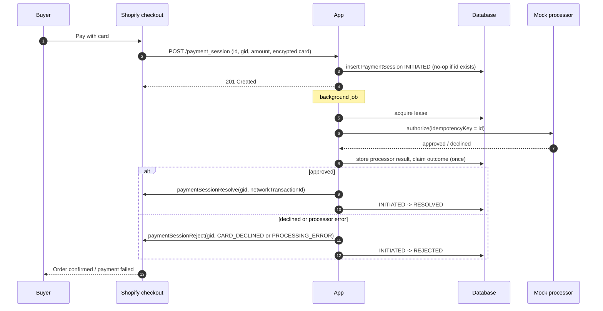
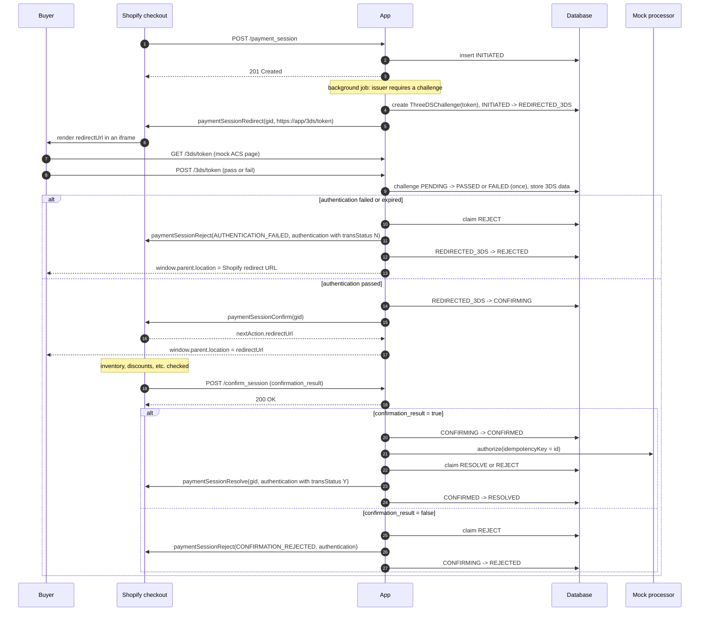
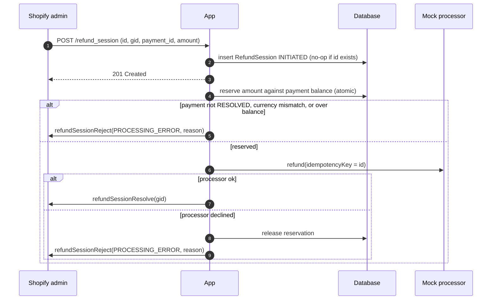

# Payment flows

Shopify identifies a payment by `id`, which is the idempotency key in requests, and by `gid`, which is used in mutations. Every arrow into **App** is persisted before the app responds. Every mutation is sent only after the outcome has been claimed in the database.

## Non-3DS

## 3-D Secure

Shopify fails resolve or reject for a confirmed 3DS session until it has sent the confirm callback. The state machine enforces the same rule: there is no `REDIRECTED_3DS -> RESOLVED` or `CONFIRMING -> RESOLVED` edge.

## Refund

## Retries and duplicates (summary)

| Event | Handling |
| --- | --- |
| Shopify resends `/payment_session` with the same `id` | Stored once; returns `201`; no new work if past `INITIATED` |
| Two workers process one session | DB lease, plus a compare-and-set transition; processor call keyed by `id` |
| Resolve and reject race | `outcome` claim succeeds once; the loser sends nothing |
| Shopify GraphQL `5xx`, `429` or network error | Exponential backoff; the outcome stays claimed; recovery resends the same mutation |
| Duplicate `/confirm_session` | Ignored unless the session is `CONFIRMING` with no result recorded yet |
| Buyer double-submits the 3DS form | Challenge `PENDING -> PASSED/FAILED` is a compare-and-set; the second submit gets the stored return URL |
| Process crash after `201` | `resumeInFlightWork()` re-enqueues unfinished sessions on boot |
